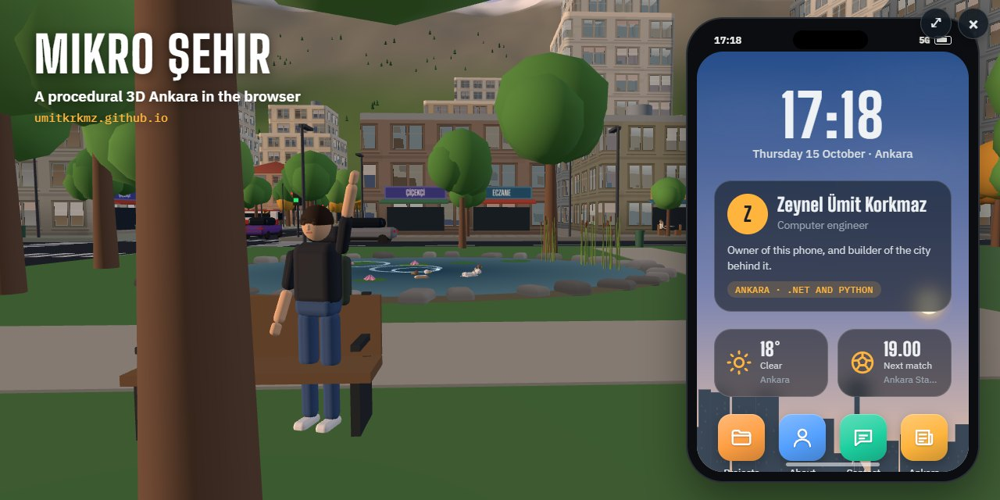
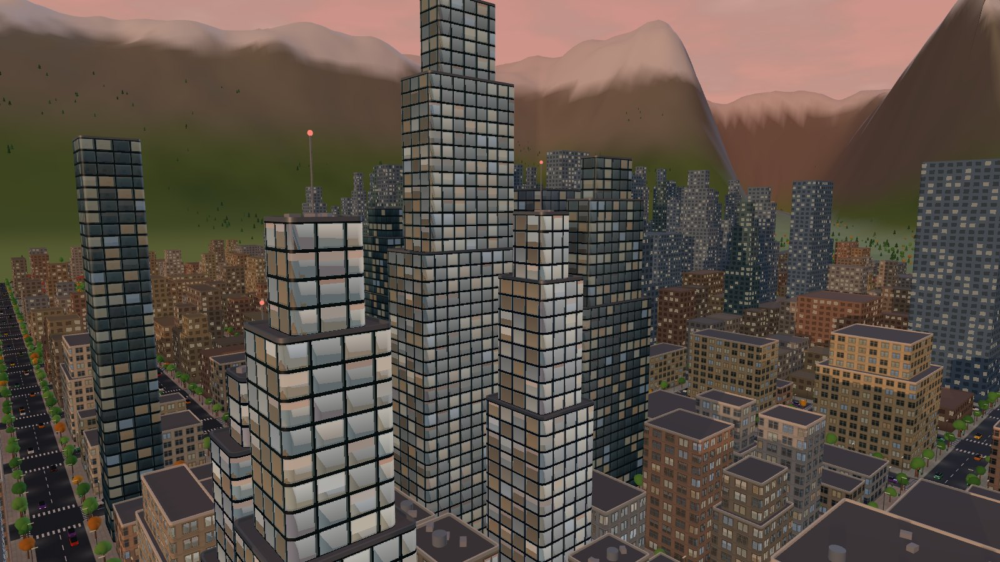
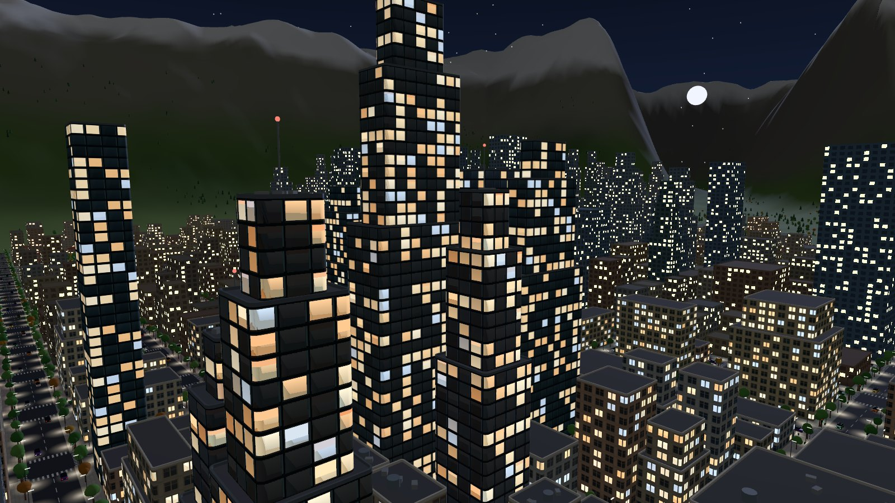
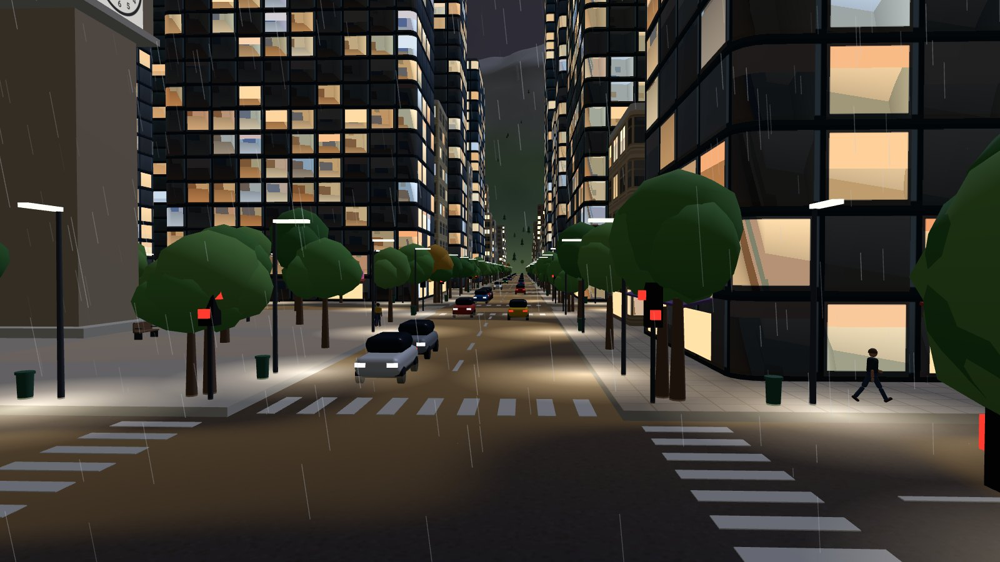
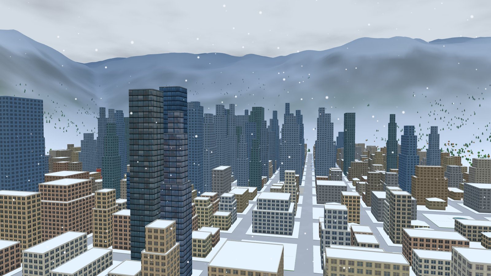

# Mikro Şehir

**A procedural 3D Ankara that runs in the browser, and my portfolio hidden in a developer's phone.**

**Live:** https://umitkrkmz.github.io

[](https://umitkrkmz.github.io)

| | |
|---|---|
|  |  |
|  |  |

Zoom from a bird's-eye view down to the street. The city runs on real Turkey time and Ankara's live weather. There is traffic, emergencies, street cats, a football match in real time, shops you can walk into, and a kid in pajamas swinging between rooftops. Press **Find me** to meet the developer and open the phone.

## What it is

- Plain JavaScript and [Three.js](https://threejs.org/) r128 with custom GLSL. No build step, no framework, no backend.
- A hobby project built step by step with an AI coding agent (Claude Code). `CLAUDE.md` is the map the agent works from.
- My portfolio: the phone is a standalone page (`portfolio/`) that also opens on its own.

## What it isn't

- Not a map of the real Ankara. The district and street names are real; the layout is invented.
- Not a game engine or a library you can import.
- Not tracking you. The only outside requests are Open-Meteo (weather) and the GitHub API (project info), both without keys or accounts.

## Run it locally

Open `index.html`, or serve the folder and visit `http://localhost:8123`:

```bash
python tools/devserver.py
```

You need WebGL and an internet connection (Three.js and fonts come from a CDN). The interface is in English and Turkish, picked automatically, with a switch in the controls.

## Make your own

`PROMPT.md` explains how to make this repository yours, or how to build a city of your own from scratch with an AI agent.

## License

[MIT](LICENSE)

---

### Türkçe

Tarayıcıda çalışan prosedürel bir 3B Ankara ve bir geliştiricinin telefonuna saklanmış portfolyom. Kuş bakışından sokağa kadar yaklaşabilirsin. Şehir gerçek Türkiye saatiyle ve Ankara'nın canlı havasıyla yaşıyor: trafik, olaylar, sokak kedileri, gerçek süreli maç, girilebilir dükkânlar ve çatılarda sallanan Pijamalı Çocuk. **Beni bul**'a bas, geliştiriciyle tanış, telefonu aç. Derleme yok, sunucu yok, hesap yok; yerelde `python tools/devserver.py` ile açılır.
